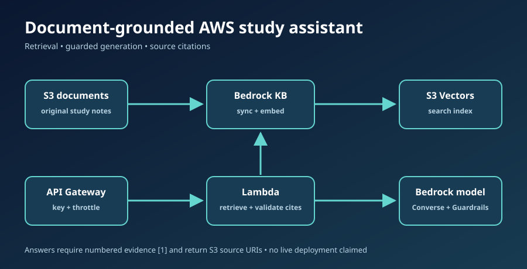
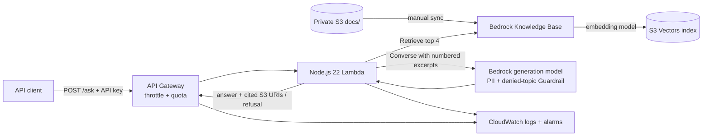

# Bedrock RAG assistant with citations — PoC #4

A deployable **AWS CDK TypeScript** proof of concept for an AWS study-note assistant: retrieve from a small, original document set, answer only with evidence, and return source S3 URIs. **Infrastructure and code only: not a live demo.** Nothing has been deployed or published; results and actual bills are pending.



## Architecture



- The **documents bucket** is encrypted SSE-S3, private, versioned, TLS-only, with no automatic object deletion. `docs/` is the only synced prefix. `corpus/*.md` comprises three short **original** notes; `NONE` chunking treats each small document as one chunk. An operator uploads and starts an ingestion job **after** deployment; CDK only creates the Knowledge Base and data source, not the job. Sync again after edits. Until ingestion succeeds, retrieval returns nothing and the API refuses.
- The **S3 Vectors** bucket/index use SSE-S3 and 1,024-dimensional float32 cosine vectors for the default Amazon Titan Text Embeddings V2 model. S3 Vectors is chosen to avoid an idle OpenSearch Serverless collection's minimum capacity cost. The embedding model is configurable but any replacement must output **1,024 dimensions** or the index definition must be adjusted; replacing an in-use index may require a new KB/index and re-ingestion. Vector buckets are not conventional S3 buckets: they have distinct IAM permissions and lifecycle/teardown behavior. The deployed CDK version includes `aws-s3vectors.CfnVectorBucket/CfnIndex` and Bedrock `S3_VECTORS` CFN support; **older CDK/CloudFormation region versions may not**. Test resource-type availability in your target region before deploying; no OpenSearch fallback is provisioned.
- **Lambda** retrieves at most four S3-backed excerpts, truncates each to 1,500 chars, and prompts a configurable model with those excerpts explicitly marked untrusted. No retrieved evidence → deterministic refusal. It only returns model text if an end-turn response cites valid excerpt numbers; unknown/missing citations, truncation, or model refusal become refusals. The response includes *only cited* S3 locations. This checks citation **syntax/provenance, not semantic entailment**: model claims can still be unsupported, and retrieved results can be irrelevant. There is no relevance-score cutoff. Do not interpret citations as proof of correctness.
- A versioned **Bedrock Guardrail** blocks email/phone PII and the denied topic of credential theft for Converse input/output. Guardrails can miss sensitive content and do not validate factual grounding. Retrieval itself does not run a guardrail; the selected excerpts enter the guarded Converse prompt. Do not ingest confidential documents into this public-demo design. The use of S3 source URIs reveals source names, so do not include sensitive names. Source text may include adversarial instructions; the system prompt treats it as data, but this is not a complete prompt-injection defense.
- **API Gateway** requires a generated API key, throttles at 2 requests/second with burst 4, and adds a 100-requests/day *per-key* usage quota. The key is for demo metering, **not identity authentication** or an account spending cap. Do not distribute it publicly; add Cognito/IAM authorization and WAF before multi-user or production use. API access logs exclude payloads; Lambda logs only exception types, not questions or answers. API 5xx and Lambda error alarms have no notification target; attach one for operations. No tracing of request payloads is enabled.
- IAM scopes runtime Bedrock retrieval to this KB, generation to the selected model and guardrail to this guardrail; the KB role is limited to `docs/`, the embedding model and its vector index. CloudFormation deployer permissions, API key users, and uploader permissions are separate. Default model IDs in `cdk.json` are **examples** and must be supported in the deployment region/account. Both generation and embedding IDs are configurable with `-c embeddingModelId=... -c generationModelId=...` (foundation model IDs, not inference-profile IDs); source policy derives model ARNs from these IDs. Models requiring inference profiles need corresponding IAM/model ARN adjustments. **Enable/verify Bedrock model access in the Bedrock console** and check region availability, guardrail features and quotas before deployment.

## Prerequisites and local checks

Node.js 22+, npm, Python 3.12+ with pytest, AWS CLI v2 for upload/ingestion and a bootstrapped CDK account/region for deployment. No AWS credentials are needed for local tests/synth. No API keys or long-lived AWS secrets belong in this repository.

```bash
npm install
npm run lint
npm test
python -m pip install pytest
python -m pytest tests/test_evaluate.py -x -q
npm run synth -- -c stage=dev
npm run synth -- -c stage=prod
```

## Deploy, ingest, and evaluate (manual, AWS account required)

The following commands are *instructions*, not evidence of a completed deployment. Pick a supported region and check Bedrock/S3 Vectors availability. Configure AWS Budgets and a sandbox account first. `dev` and `prod` are **names**, not separate accounts.

```bash
npx cdk bootstrap aws://$AWS_ACCOUNT_ID/$AWS_REGION
npx cdk deploy BedrockRag-dev -c stage=dev
# Record stack outputs: DocumentsBucketName, VectorBucketArn, KnowledgeBaseId,
# DataSourceId, ApiUrl, ApiKeyId. Substitute actual values below.
aws s3 cp corpus/ "s3://$DOCS_BUCKET/docs/" --recursive --exclude '*' --include '*.md'
aws bedrock-agent start-ingestion-job --knowledge-base-id "$KB_ID" --data-source-id "$DS_ID"
# Record the returned ingestionJobId; confirm COMPLETE before sending queries:
aws bedrock-agent get-ingestion-job --knowledge-base-id "$KB_ID" --data-source-id "$DS_ID" --ingestion-job-id "$JOB_ID"
# API key ID is not its value. Retrieve via an authorized principal; don't echo or commit it:
export RAG_API_KEY="$(aws apigateway get-api-key --api-key "$KEY_ID" --include-value --query value --output text)"
python scripts/evaluate.py --url "$API_URL"
unset RAG_API_KEY
```

The CLI uploader needs `s3:PutObject` for `docs/*` and `bedrock:StartIngestionJob`/`bedrock:GetIngestionJob` for the KB/data source; the script does not provision a human principal. `scripts/evaluate.py` sends three questions and checks that answers cite the expected source filenames (not that answers are actually correct). It exits nonzero on failures, does not print key values, and must run **only against an endpoint you control**. For a direct request use `POST /ask` with `Content-Type: application/json`, `x-api-key`, and `{"question":"..."}`. Responses have `answer` and `citations: [{"id":1,"source":"s3://.../docs/security.md"}]`; a refusal has empty citations. Passing flags is not a production evaluation.

### Teardown

```bash
# DEV ONLY: delete document versions/delete markers deliberately; `aws s3 rm` alone
# does NOT empty a versioned bucket. Record outputs before deleting the stack.
# Inspect and delete all docs bucket versions and delete markers with your own reviewed procedure.
# Remove indexed vectors / delete the index if CloudFormation cannot delete a nonempty vector index.
npx cdk destroy BedrockRag-dev -c stage=dev
```

CDK `DESTROY` in dev is not auto-delete: **stack destruction can fail while either bucket/index contains data**. Stop ingestion, delete indexed contents/index as needed, empty all versions and delete markers from the documents bucket (e.g. S3 console), then retry. Vector deletion may require S3 Vectors CLI support in your AWS CLI version; do not assume the standard `aws s3` commands work. `prod` retains docs bucket/vector resources on stack deletion; record IDs and manage them manually. Model invocation, vector storage, logs, bootstrap assets and retained resources can continue costing money if left behind.

## CI/CD

`.github/workflows/ci.yml` uses `npm install`, lint, unit/assertion tests, Python evaluation-helper tests and dev synth on PRs/pushes. **Only** `workflow_dispatch` runs CDK deploy, using GitHub OIDC and environment-scoped `AWS_DEPLOY_ROLE_ARN` plus `AWS_REGION`; protect the prod environment with approval. Restrict the role trust to the intended repository/environment/refs, limit deploy permissions to its account/CDK bootstrap/stack, and review the synth diff. Deployment does not upload documents, run ingestion or publish a repo. No static AWS keys are configured. This workflow is included for future use, not activated here.

## Responsible AI

Grounding/refusal and structured source references reduce some hallucinations, but a citation can be spurious, an irrelevant chunk may be retrieved, and model answers may omit nuance. Evaluate answer quality and exact claim support manually before trusting output. The three original notes are simplified exam-prep illustrations, not authoritative AWS documentation or certification exam questions. Guardrail PII/topic filters are fallible; input and output can contain material needing additional moderation. Prompt injection in documents remains a risk: keep ingestion restricted, review corpus changes, separate external content, and do not allow tool execution or privileged actions from document text. Do not log sensitive prompts, store regulated content here or treat this system as production-ready.

## Well-Architected review (design-time, not an audit)

**Operational Excellence** — CDK, source-controlled corpus, explicit ingestion and alarms are repeatable; add alert actions, ingestion status monitoring, dashboards and runbooks.

**Security** — Private encrypted TLS-only docs, scoped service roles, guarded inference and no response payload logging. API keys alone are weak authorization; guardrails are not DLP. Use Cognito/IAM, WAF, resource policies, KMS and data classification for real users.

**Reliability** — Empty retrieval and model failures fail closed; ingestion and vector availability need integration tests. There is no retry/backoff on transient SDK failures, multi-region failover, or automatic indexing after document updates.

**Performance Efficiency** — Bounded top-four retrieval, short excerpts and low-temperature model inference keep requests small; benchmark relevance, latency and model choice on deployed traffic before tuning.

**Cost Optimization** — S3 Vectors avoids the always-on minimum capacity of OpenSearch Serverless. S3 requests/storage and vectors, embedding on ingestion, generation and guardrail per request, API Gateway, Lambda, logs and alarms still cost money. API quota is not a monthly account cap; set AWS Budgets externally and verify regional pricing using [AWS Pricing Calculator](https://calculator.aws/).

**Sustainability** — Small corpus and bounded prompts limit unnecessary inference. Compare model energy/performance and expire or remove stale artifacts deliberately; no environmental footprint was measured.

## Illustrative cost note (not a bill)

For a hypothetical sandbox with three short docs, a one-time sync, a few evaluation requests and one alarm, costs should be reviewed as **usage-dependent**, not quoted or measured here. Exact rates and minimums vary by region, chosen models, token counts, guardrail assessments, vector operations/storage, logs and API requests. An idle collection is *not* provisioned, but it is still possible to overspend through repeated inference or retaining data. Inspect the pricing calculator and set account budgets before use.

## Results: Pending deployment

The code includes local unit tests, assertions and synth only. No AWS resources, real question/answer quality, actual citations, guardrail behavior, latency, observed spend or availability have been measured. Once deployed, record ingestion status, golden-set expected-source pass rate, manually reviewed claim support, refusal tests, PII/denied-topic behavior, response latency, alarms and actual bill.

## Caveats

- This CDK release synthesized `AWS::S3Vectors::VectorBucket`, `AWS::S3Vectors::Index` and Bedrock `S3_VECTORS`; target-region CFN support and service permissions **were not deployed or verified**. A region without these types cannot deploy this design; no expensive OpenSearch fallback is silently enabled.
- Generated S3 sources are returned as URIs, not signed browser links; KB ingestion and generation may have region-specific IAM/model-access requirements not caught by synth. Model IDs may need a different ARN/inference-profile policy.
- The evaluation is a small expected-filename check, not a correctness benchmark. Check non-evidence refusal and guardrail intervention manually after deployment; tuning, tests for relevance and abuse, stronger auth and human-reviewed citations are prerequisites for production.
